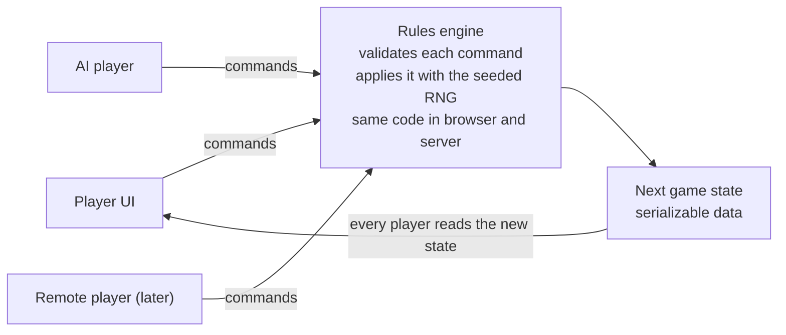

# Hexlords — Design Doc

Snapshot of the design doc as of 2026-10-29. This file is the source of truth for the build; update it when a rule changes.

## Overview

A browser-based, turn-based fantasy strategy game in the spirit of Warlords (1990): capture cities, build armies, and send heroes into ruins. The proof of concept is single-player against AI. Multiplayer and genre reskins come later, but they shape the architecture now.

- **Platform:** browser, installable as a PWA, so phones and desktops run one codebase.
- **Core loop:** cities are the only economy, stacks of up to 8 units move on one map, and combat resolves automatically with odds shown up front.
- **Session length:** 30–45 minutes on a small map.

**Proof-of-concept scope**

- One handcrafted map for balancing (about 30×24 hexes, 15–20 cities), then a seeded map generator
- 4 factions sharing 6 unit types, plus one unique unit each
- City production, movement, stack combat, retreat, and fog of war
- Heroes exploring ruins for gold, items, or allies
- Out of scope: diplomacy, complex items, a map editor, multiplayer

## Architecture

The game is a pure, deterministic state machine. The AI, multiplayer, replays, and reskins all follow from that one decision.

- **State** is plain serializable data: map, cities, stacks, units, heroes, gold, and turn.
- **Commands** are data objects: Move, Attack, SetProduction, Explore, EndTurn. The engine validates each one and returns the next state.
- **Randomness** comes from a seeded RNG stored in the state, so every battle can be replayed and checked.
- **One engine everywhere:** the same TypeScript module runs in the browser now and on the server for multiplayer later.

What this gets us:

- The AI is just another player sending commands, with no special hooks.
- Multiplayer sends the same commands to an authoritative server. Hot-seat play comes almost free as a first step.
- Save/load, replays, and undo need little extra work.



Players, the AI, and later remote players all send commands. The engine is the only code that changes state, and everyone reads the result.

**Reskinnable content**

The engine knows mechanics, not theme. Mechanics use generic tags such as "forest-native", "regenerates", or "leads stack", and all names, stats, and art live in data files. Code uses neutral terms: heroes are commanders and ruins are sites. A reskin is a content pack, not a rewrite.

**Tech stack**

- TypeScript rules engine with no rendering dependencies
- PixiJS to draw the map
- PWA packaging so the game installs on phones
- Maps built in Tiled and exported as JSON

## Combat

Battles resolve automatically as a chain of one-on-one duels, and the exact odds are shown before the player commits.

**Unit stats**

- **Strength** (1–9) sets how often a unit lands a hit.
- **Hits** is how much damage a unit can take: 2 for regular units, 3 for heroes and elites. (Decided: stay with 2 hits for regular units; revisit 4 only if damage feels too coarse in playtesting.)

**Resolution**

1. Each side lines up weakest first. Among equal Strength, healthy units fight before wounded ones.
2. The front units duel. Each round, one of them lands a hit; the attacker's chance is shown below.
3. A unit at zero hits dies. The winner keeps its damage and faces the next enemy.
4. The battle ends when one side has no units left or retreats.

```math
P(\text{attacker hits}) = \frac{A}{A + D}
```

A and D are the effective Strengths of the two dueling units. Only the ratio matters, so 6 vs 3 plays the same as 4 vs 2.

**Modifiers**

- All bonuses are percentages: effective Strength = base × (1 + total bonus).
- Bonuses add before multiplying, so forest +25% and leadership +25% make +50%.
- Each unit's total bonus is capped at +50%; the cap applies per unit, since some bonuses (archers defending, a hero's sword) affect only one unit. Penalties, such as −25% attacking across a ford, never drop Strength below half.
- A siege unit's −25% applies only to the enemy city's defense bonus and never takes it below zero: a city's +25% becomes +0%, a capital's +50% becomes +25%, and a village stays at +0%. Several siege units in one stack do not add up.
- Modifiers are fixed when a battle starts. Stack-wide effects last the whole battle even if their unit dies.

**Odds preview**

Exact win probability and expected survivors come from a memoized recursion over remaining units and hits, which runs in microseconds. The AI uses the same function to judge attacks. The battle itself draws from the seeded RNG.

**Reference odds** (2 hits per unit)

| Matchup | Attacker wins |
| --- | --- |
| Duel, Strength 5 vs 4 | 58% |
| Duel, Strength 6 vs 4 | 65% |
| Duel, Strength 9 vs 3 | 84% |
| 8 Strength-4 units vs 4 Strength-8 units (equal cost) | 52% |
| 4 vs 4 Strength-4 units, defender +25% | 33% |
| 4 vs 4 Strength-4 units, defender +50% | 21% |

More hits per unit means less luck: Strength 6 vs 4 wins 60% with 1 hit, 65% with 2, and 68% with 3.

## Retreat, pursuit, damage and healing

A losing stack can retreat to save its survivors, but it pays with a pursuit strike and wounds that last until healed.

**When retreat happens**

- City garrisons never retreat; they fight to the last unit.
- The attacker sets a win-chance threshold in the odds preview, such as "withdraw if win chance drops below 30%". After each duel the engine recomputes the exact odds and withdraws if they fall below it.
- Field stacks carry a standing order, because a defender is not online during the attacker's turn in async multiplayer:
  - **Hold:** fight to the last unit.
  - **Fall back:** retreat if win chance drops below a set threshold.
  - **Evade:** Fall back at 50%, but leave before the first duel when possible. Before any duel, the stack evades if its own exact win chance is below 50%, every evading unit is at least as fast as the attacker's fastest unit (the same test as a clean break), and it has a legal retreat hex. An evading stack takes no pursuit and fights no battle, and loses movement like any retreating stack. If it cannot evade, it fights as Fall back at 50%.
- Stances are public: anyone who can see a stack sees its stance, shown as a banner on the stack. The odds card's exact numbers depend on it, and Evade should be something the attacker plans around, not a surprise.
- A defender on Fall back gets the mirror-image check at the same moments: it withdraws if its own win chance drops below its threshold. The attacker's check runs first, so if both sides would withdraw at once, the attacker does and the defender keeps the hex.
- Retreat checks happen between duels, never during one. Thresholds use win chance, not units lost: the weakest units fight first and die early in almost any battle. In the mockup's attack on Gravelmaw, "withdraw after losing 2 units" turned 81% odds into a 4% win rate, while "below 30%" keeps 79%.

**Where retreating stacks go**

- A withdrawing attacker stays in the hex it attacked from, so it can always withdraw.
- A withdrawing defender moves to one of the three adjacent hexes at distance 2 from the attacker, the hexes behind it; surrounding a stack means blocking those three. The hex must be one every unit in the stack can enter and must hold no enemy. A hex with a friendly stack counts if the merged stack stays at 8 units or fewer, and the stacks merge.
- Among legal hexes: a friendly city first (it heals faster and defends better), then the lowest move cost for the stack, then a fixed direction order.
- If no such hex exists, the stack cannot retreat and its Fall back check is skipped. Encirclement, rivers, and passes matter.
- A defender that retreats starts its next turn with half its movement.
- An attack ends the attacking stack's movement for the turn, whatever the result. If the defenders are destroyed or withdraw, the attacker moves into their hex for free, but only if every unit in the attacking stack can enter it: a stack without dwarves that beats dwarves on a mountain stays where it is.

**Pursuit**

- The winner's fastest unit (ties: the one with more pursuit strikes, then the strongest) strikes the retreating stack's weakest surviving unit. Most units strike once; Horse Archers strike twice. This works the same whichever side withdraws.
- The strike lands with the usual chance, P ÷ (P + T), and the target cannot hit back.
- **Clean break:** no pursuit if every retreating unit is at least as fast as the pursuer. This is checked once, when the withdrawal starts, against every unit that withdraws. The slowest unit sets the column's pace, so a strike that kills it doesn't let the rest escape the remaining strikes.
- A killing strike removes the unit before the stack reaches its retreat hex.
- If pursuit kills every retreating unit, the battle counts as that stack destroyed, not as a retreat: the odds preview and the result card show it as a loss for the side that withdrew.

**Persistent damage**

- Units keep their remaining hits between battles, shown as pips on the unit card.
- Wounded units fight at full Strength; their only penalty is fewer hits to lose.
- New units leave production at full health.

**Healing**

| Where | Recovery |
| --- | --- |
| In the field, stack did not move or fight | 1 hit per unit per turn |
| Friendly city | 2 hits per unit per turn |
| Temple | Full heal, plus a one-time +25% blessing for the next battle (once per stack per temple) |

## Map and terrain

The map is a hex grid sized by travel time, where roads, chokepoints, and cities with their own build lists decide where wars are fought.

**Grid and size**

- Hexes: every neighbor is the same distance away, and tap targets are larger than squares.
- Neighboring cities sit 2–3 infantry turns apart cross-country; rival capitals 8–10 turns.
- POC map: about 30×24 hexes for 4 factions and 15–20 cities.

**Terrain**

Movement costs are doubled so roads can cost half without fractions. Infantry has 8 points per turn, or 4 plains hexes. Terrain bonuses help only the defender.

| Terrain | Move cost | Effect |
| --- | --- | --- |
| Road | 1 | Fast routes between cities |
| Plains | 2 | None |
| Forest | 4 | Defender +25% |
| Hills | 4 | Defender +25%, extended vision |
| Swamp | 6 | Mostly an obstacle |
| Mountains | Impassable | Fliers cross; dwarves cross at 6 |
| Water | Impassable | Fliers cross; ships come later |
| River | Impassable | Crossable at bridges (move cost 1) and fords (move cost 4); a stack attacking from a ford hex into a hex that is not a ford gets −25% |

**Cities**

Each city has its own build list, so a few cities, such as the only griffin roost, are worth fighting over. A city's defense bonus replaces the terrain bonus rather than stacking with it.

| Tier | Defense | Income (gold per turn) |
| --- | --- | --- |
| Village | +0% | 5 |
| City | +25% | 10 |
| Capital | +50% | 20 |

**Soft zone of control**

- Hexes next to an enemy stack are contested.
- A step from one contested hex to another hex next to the same enemy stack costs +2 movement.
- Approaching, attacking, and backing away cost normal movement; only sliding past is taxed.
- Fliers ignore zone of control. City garrisons project it like any other stack.
- Only visible enemies count. A stack that spots a hidden enemy stops so the player can re-plan.
- Selecting a stack shades contested hexes, and the path preview shows the true cost.
- Costs are fixed during a turn, so the AI's pathfinding stays a standard shortest-path search.

**Fog of war and map authoring**

- Each unit has a vision radius, 2 hexes by default, and a stack on hills sees 1 hex farther. Cities see 2 hexes for their owner.
- Maps are built in Tiled, a free editor with hex support and JSON export. Ruins, temples, and build lists are object properties, so maps stay pure data.

**Generated maps**

A seeded generator follows the handcrafted map. The same seed always builds the same map, so players can share a map as a short code.

1. Lay out terrain from layered noise: elevation sets water, plains, hills, and mountains; moisture sets forest and swamp.
2. Place capitals at equal travel distance, then cities and villages so each faction has a similar number within reach.
3. Connect cities with roads using the movement pathfinder, adding bridges and fords where roads cross rivers.
4. Scatter ruins and temples, with harder ruins farther from capitals.
5. Reject and regenerate any map that fails fairness checks, such as capital travel times or special build lists bunched near one start.

The handcrafted map stays the fixed baseline for tuning, since a changing map makes balance changes hard to read. AI-vs-AI games on many seeds can then test the generator's fairness.

## Economy

Gold comes only from cities, units cost 2 × Strength × Hits plus ability premiums, and upkeep makes idle armies expensive.

**Pricing**

The battle math shows that combat value equals Strength × Hits. A Strength-8 unit is worth two Strength-4s, and 3 hits are worth 1.5 times 2 hits. So cost can scale linearly:

```math
\text{cost} = 2 \times \text{Strength} \times \text{Hits} \times (1 + \text{premiums})
```

- Premiums: +25% for speed, +50% for flying, about +25% for other specials.
- Elite units may need a small extra premium, because the 8-unit stack limit rewards packing power into one army.

**Income and production**

- Income comes from cities by tier (see Cities): 5, 10, or 20 gold per turn.
- Each city builds one unit at a time from its own list: 1 turn for basic units, 2–3 for elites.
- Gold and city build slots both limit growth, so more cities means more output, not just more money.

**Upkeep**

- Each unit costs 12% of its base price per turn, rounded, minimum 1 (listed in the unit tables), so it costs its full price again about every 8 turns. Faction discounts lower the purchase price, not upkeep.
- Heroes pay no upkeep; their cost is the hiring price.
- When gold runs out, production stops first. Then the most expensive unit deserts each turn.

**Capturing a city**

| Choice | Effect |
| --- | --- |
| Occupy | Keep the city and its income |
| Pillage | Take several turns of its income now; the city drops a tier |
| Raze | Destroy it so nobody can use it |

## Units and factions

Six shared units cover every role, and each faction adds one trait and one unique unit, each testing a different core system.

**Shared roster**

| Unit | Strength | Hits | Move | Cost (gold) | Build (turns) | Upkeep (gold per turn) | Role |
| --- | --- | --- | --- | --- | --- | --- | --- |
| Militia | 2 | 2 | 8 | 8 | 1 | 1 | Garrisons and screens; fights first and absorbs pursuit |
| Archers | 3 | 2 | 8 | 15 | 1 | 2 | +25% when defending |
| Infantry | 4 | 2 | 8 | 16 | 1 | 2 | Backbone of every army |
| Cavalry | 4 | 2 | 12 | 20 | 2 | 2 | Pursuit, raids, clean breaks |
| Siege engine | 2 | 2 | 6 | 20 | 2 | 2 | Its stack cuts the enemy city bonus by 25 points, never below 0 |
| Griffins | 5 | 2 | 16 | 30 | 3 | 4 | Flying; only a few cities build them |

Dragons (Strength 8, 3 hits, flying) are never built. They join only as allies from ruins.

There are no rock-paper-scissors counters. Units differ by speed, terrain, and city attack or defense, which keeps odds readable and the AI's evaluation simple.

**Factions**

| Faction | System it tests | Trait | Unique unit |
| --- | --- | --- | --- |
| Elves | Terrain | Forest costs the same as plains | Rangers |
| Dwarves | Map | Cross mountains at 6 movement per hex | Ironguard |
| Horse Clans | Pursuit | Mounted units (Cavalry, Horse Archers) build 1 turn faster and get +25% attacking on plains | Horse Archers |
| Orc Horde | Economy and healing | Militia and infantry cost 25% less; pillage yields double gold | Trolls |

**Unique units**

Priced with the same formula as the shared roster: 2 × Strength × Hits, plus +25% for speed and +25% for each other special.

| Unit | Faction | Strength | Hits | Move | Cost (gold) | Build (turns) | Upkeep (gold per turn) | Special |
| --- | --- | --- | --- | --- | --- | --- | --- | --- |
| Rangers | Elves | 4 | 2 | 8 | 24 | 2 | 3 | +25% when defending, like archers; ignore zone of control in forest |
| Ironguard | Dwarves | 5 | 3 | 6 | 30 | 2 | 4 | None; slow movement offsets the dense stats |
| Horse Archers | Horse Clans | 3 | 2 | 12 | 18 | 1 (2 before the trait) | 2 | Mounted; strike twice when pursuing |
| Trolls | Orc Horde | 5 | 3 | 8 | 38 | 2 | 5 | Heal 1 hit per turn even while moving |

Horse Archers are weaker than Cavalry in a straight fight and cheaper; their job is punishing retreats. Their two pursuit strikes resolve one at a time against the weakest surviving withdrawing unit, so the second strike can finish a unit the first one wounded.

Traits are generic tags in the data files, such as "forest-native", "mountain-walker", and "regenerates". A reskin renames them without code changes.

## Heroes

Heroes lead stacks, explore ruins for gold, items, and allies, and grow over five levels. Death is permanent.

**Base hero**

- Strength 5, 3 hits, 10 movement.
- **Leadership:** +25% to the whole stack. Only one hero's leadership counts per stack, inside the +50% cap.
- Heroes fight in normal Strength order, usually after militia and infantry, so they die only when the stack is clearly losing.

**Ruins**

A hero enters a ruin alone and duels its guardian, with odds shown first. Rewards are gold, an item, or allies.

| Ruin | Guardian | New hero wins | After 2 levels (Strength 6, 4 hits) |
| --- | --- | --- | --- |
| Minor | Strength 4, 2 hits | 77% | 91% |
| Major | Strength 6, 3 hits | 42% | 66% |
| Dragon lair | Strength 8, 3 hits | 29% | 51% |

At 1 hit left, the hero may flee. The guardian gets a pursuit strike, and the hero returns wounded with nothing.

**Leveling**

- Experience equals Strength × Hits of each enemy defeated, the same as combat value.
- At each level, up to 5, the player picks +1 Strength, +1 hit, or a perk.
- **Warlord:** leadership rises to +50%.
- **Scout:** +4 movement and more vision.
- **Quartermaster:** the stack heals 1 extra hit per turn.

**Items and allies**

- A hero carries up to 3 items, such as a sword (+25% hero Strength) or boots (+2 movement for the stack).
- When a hero dies, the items drop on that hex for anyone to pick up.
- Allies from ruins join the hero's stack with no upkeep and leave if the hero dies.

**Hiring**

- Each faction starts with one hero, up to a maximum of 3.
- Every few turns, a hiring offer appears at one of your cities.
- The price is 40 gold for each hero you currently own: 40 for a second hero, 80 for a third. If a hero dies, the price drops back.
- Heroes pay no upkeep. For AI scoring, a hero is worth its current hiring price plus its levels and items.

## Victory

Score is city income, a city counts only once it is secured, and a player wins by domination, by eliminating every rival, or by leading when the turn limit runs out.

**Score**

- Score = income from cities held: 5 per village, 10 per city, 20 per capital. Everyone sees it on the scoreboard, and the AI's leader bonus uses it.
- A city is **secured** once held for a full round, from the start of one of your turns to the start of the next. Only secured cities count toward victory, which removes the last-mover advantage.

**Ways to win**

| Condition | Rule |
| --- | --- |
| Domination | Start your turn with at least 50% of the map's total income secured |
| Last player standing | Every rival eliminated |
| Turn limit | Highest secured score when the last turn ends; ties go to the larger army by gold value |

Example: a map with 4 capitals, 6 cities, and 8 villages has 180 total income, so domination needs 90. Everyone starts at 20.

Each map sets its own turn limit. Start around 40 turns, about 40 minutes at a minute per human turn, then set it a little past the length of decisive AI-vs-AI games.

**Last stand**

When a player's current income passes 50%, every player sees a warning. The AI's leader bonus doubles to +50% while that player stays above 50%, so the leader must hold out for a full round against everyone.

**Elimination and resigning**

- A player who starts a turn with no cities is eliminated immediately, and their units disband. There is no exile period.
- In multiplayer, a player who resigns leaves their cities neutral, garrisons included.

**Victory conditions are map data**

The map file defines its victory conditions; the default is domination plus a turn limit. Scenarios can set their own goals, such as holding one city for 10 turns, without code changes.

## AI opponents

The AI scores every option in gold, plays under the same fog of war as the player, and leans modestly against whoever is leading.

**Turn sequence**

1. **Assess threats:** for each hex, total the enemy and friendly strength that can reach it within 2 turns, using the real pathfinder with terrain and zone of control.
2. **List goals:** capture a city, defend a city, explore a ruin, heal a wounded stack, pick up dropped items.
3. **Score goals:** expected gain minus expected losses, divided by the turns needed to get there.
4. **Assign stacks**, best goal first. A goal that needs several stacks gets a task force, which gathers at a staging hex before attacking.
5. **Execute:** Move and Attack commands, then stances and retreat thresholds.
6. **Produce:** each city builds whatever the goals were short of.

**Scoring in gold**

Unit cost already equals combat value, so every option can be priced in gold and compared directly.

| Option | Score |
| --- | --- |
| City | 15 turns of its income, plus a premium for capitals and rare build lists |
| Attack | P(win) × target value + expected enemy losses − expected own losses |
| Ruin | P(win) × expected reward − P(lose) × hero value (hire cost, levels, items) |
| Retreat threshold | The win-chance threshold with the best expected value, run through the odds function |

Example: 60% odds on a 10-gold city (worth 150), killing 50 gold of defenders and losing 40, scores 0.6 × 150 + 50 − 40 = 100.

**Leader bonus**

- The leader is the player with the most city income, human or AI. The scoreboard shows this to everyone, so the AI needs no hidden information.
- When the leader has at least 25% more city income than second place, goals against the leader's cities and stacks score +25%.
- It tilts scoring rather than forming an alliance: AIs still take easy targets from each other.
- During a last stand (see Victory), the bonus doubles to +50%. Both 25% values are starting points to tune in simulation.

**Fair fog of war**

- The AI reads the same per-player view a multiplayer server would send, so it cannot cheat even by accident.
- It remembers where it last saw enemy stacks and trusts that memory less each turn.
- Difficulty comes from production bonuses, not hidden information.

**Guards against common mistakes**

| Mistake | Fix |
| --- | --- |
| Changing goals every turn | The current goal scores +20% |
| Attacking one stack at a time | Task forces attack only when their combined odds pass a threshold |
| Leaving cities empty | Each city keeps a minimum garrison scaled to nearby threats |
| Chasing what it can't catch | Never pursue a stack faster than its own |

**Faction personalities**

Scoring weights live in the data files, so each faction gets a style without new code. The Orc Horde values pillage gold more, the Horse Clans favor raiding weak cities, and the Dwarves weigh defense heavily.

**Engineering**

- Runs in a Web Worker so the map stays responsive; a full turn should take well under a second.
- Ties are broken by the seeded RNG, so replays and a future server reproduce its moves exactly.
- Each turn's goal scores are logged and shown in a debug overlay.
- Headless AI-vs-AI games tune balance and check that generated maps are fair.

## User interface

The UI is designed for a phone held upright first; landscape and desktop reuse the same pieces with more room. Mockups of six screens are in `docs/mockups/`.

**Phone layout (portrait)**

- **Top bar:** gold with net income per turn after upkeep, the turn number out of the limit, and a score strip showing each faction's secured share against the 50% mark.
- **Map:** fills the screen. Drag to pan, pinch to zoom. At default zoom, hexes are about 44 px wide, so about 9 columns fit across a phone. Zoomed out, it becomes a strategic view with cities and stacks as icons, which doubles as the minimap.
- **Bottom panel:** a one-line summary of the selection that slides up to show unit cards, the odds preview, or city production.
- **Thumb buttons**, bottom right: Next stack and End turn.
- On landscape and desktop, the bottom panel becomes a side panel and a minimap sits in a corner.

**Moving and attacking**

1. Tap a stack. Reachable hexes are shaded; hexes under enemy zone of control are hatched.
2. Tap a destination. The path shows its true cost, with numbered markers for multi-turn routes.
3. Tap the destination again to confirm. On desktop, hover shows the path and one click moves.

If the path ends on an enemy, the odds card opens first: chance to win, expected survivors on both sides, each modifier on its own line, and a win-chance threshold for withdrawing. Nothing happens until the player taps Attack. Against a field stack on Fall back, the outcome bar has a fourth segment for the defender falling back; city attacks never show it.

Undo works until a move reveals something new: fog lifting, a battle, or entering a ruin.

**Panels**

| Panel | Contents |
| --- | --- |
| Stack | Units in fight order with hit pips; tap units to split; moving onto a friendly stack merges, up to 8 |
| City | Build list with cost, build time, and stats; income; garrison; rally point for new units |
| Hero | Level, perks, 3 item slots, allies; level-ups open a three-choice card; ruin odds before entering |
| Orders | Multi-turn routes, Sentry (skipped by Next stack), field stance (Hold, Fall back, Evade) |

**Reading the situation**

- **Danger overlay:** hexes visible enemies can reach next turn, reusing the AI's threat map computed from the player's own view.
- **Income overlay:** city ownership and value.
- **Turn summary:** at the start of each turn, battles against you, cities won or lost, units finished, and hero offers. In async multiplayer this is the "while you were away" screen.

**Battles and AI turns**

- Battles play as a 2–4 second duel-by-duel animation that can be skipped, ending in a result card with losses, retreat, and pursuit.
- The AI's turn shows only moves the player could see through the fog, at a chosen speed or skipped.
- End turn warns about idle stacks and cities with nothing in production.

**Implementation**

- PixiJS draws the map on a canvas; panels are HTML for responsive layout, readable text, and accessibility.
- Desktop shortcuts: N for next stack, E to end the turn, Space to confirm.
- Each faction has a distinct banner shape as well as a color, for colorblind players.
- UI text, icons, and color tokens come from the content pack, so reskins restyle the interface too.

## Open questions and next steps

The AI remains the biggest risk to the proof of concept, so it should be playtested first. All numbers above are starting values for playtesting.

- **AI tuning:** goal weights, the commitment bonus, garrison minimums, and the leader bonus get tuned in AI-vs-AI simulation.
- **Victory tuning:** the 50% domination threshold and the 40-turn default limit get tested in AI-vs-AI games.
- **Snowball control** beyond upkeep, such as supply lines that reduce distant cities' output. The leader bonus, last stand, and turn limit cover part of this; supply lines are undecided.
- **Values to tune:** zone-of-control penalty (+2 or +4), upkeep rate, elite premium, movement lost after a retreat, hiring cadence.
- **Multiplayer path:** hot-seat first, then async play with push notifications. Simultaneous turns remain an option.
- **Reskin check:** build one small non-fantasy content pack early to prove the engine has no theme baked in.
